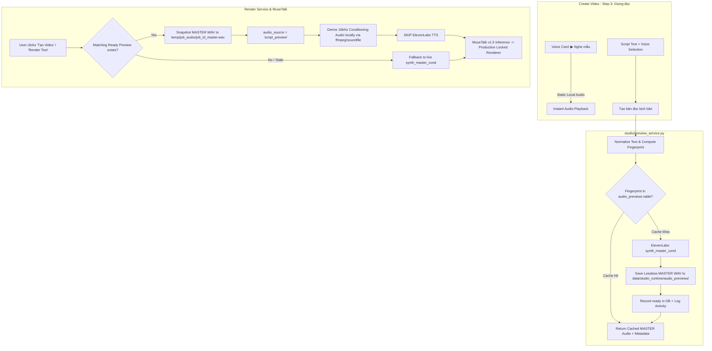

# AI AVATAR STUDIO V1.6.0 — SCRIPT VOICE PREVIEW & AUDIO REUSE IMPLEMENTATION REPORT

**Document ID:** `DOC-V1.6.0-SCRIPT-VOICE-PREVIEW-001`  
**Date:** 2026-08-29  
**Branch:** `main`  
**Status:** `IMPLEMENTATION_COMPLETE`  
**Operating Priority:** `CONSISTENCY → QUOTA SAVINGS → AUDIO REUSE → BACKWARD COMPATIBILITY → SIMPLE UX`

---

## 1. Executive Summary

This document records the full implementation and verification of the **Script Voice Preview** and **Audio Reuse** system in AI Avatar Studio V1.6.0.

Users can now:
1. **Audition Approved Voices Instantly (`▶ Nghe mẫu`):** Near-instant static sample audio playback for approved voices (**Hạnh** and **Thanh**) without consuming ElevenLabs quota on repeated clicks.
2. **Preview Full Script Reading (`BẢN ĐỌC KỊCH BẢN`):** Synthesize the exact current script text with the selected ElevenLabs voice and production-resolved TTS settings before committing GPU time to Avatar video rendering.
3. **Reuse Audio During Render with Zero Duplicate Quota:** When the user subsequently renders a video, the system deterministically matches the preview fingerprint (`preview_fingerprint = SHA256(canonical_effective_tts_request)`), snapshots the validated lossless MASTER audio, and skips ElevenLabs TTS generation during rendering (`audio_source: "script_preview"`).
4. **Benefit from Stale-Safe UI State:** Any edit to script text, voice selection, language, or model immediately flags the preview as `STALE`, showing an amber warning banner and preventing accidental reuse of mismatched audio.

---

## 2. Architecture & Invariants

### Key Architectural Invariants:
1. **Zero GPU / Model Loading in Preview:** Preview generation executes exclusively via `studio.elevenlabs_client.synth_master_cond` and local downsampling. No PyTorch GPU tensors or MuseTalk models are initialized.
2. **Master Audio Authority:** The authoritative output is a lossless MASTER WAV (e.g. 44.1 kHz for `mp3_44100_128`). 16 kHz mono conditioning audio is derived purely on-demand for MuseTalk facial conditioning.
3. **Deterministic Fingerprint:**
   $$\text{preview\_fingerprint} = \text{SHA256}(\text{Canonical JSON}(\text{normalized\_script}, \text{voice\_id}, \text{target\_language}, \text{tts\_config}))$$
4. **File-Lifetime Safety:** When enqueuing a render job with preview audio, the MASTER audio is copied into an immutable job-owned path (`temp/job_audio/<job_id>_master.wav`) so that future cache pruning cannot break pending or running render jobs.
5. **Duplicate Suppression:** Concurrency locks in `preview_service.py` prevent duplicate API requests when users click the button rapidly.

---

## 3. Evidence Classification Table

| Component / Verification | Verification Type | Status | Evidence Reference |
| :--- | :--- | :--- | :--- |
| **Fingerprint Determinism & Isolation** | `PROVEN_UNIT_TEST` | **PASS** | `tests/test_script_preview.py::test_fingerprint_determinism_and_isolation` |
| **Text Normalization (Unicode/CRLF)** | `PROVEN_UNIT_TEST` | **PASS** | `tests/test_script_preview.py::test_text_normalization` |
| **Database Migration & CRUD** | `PROVEN_REAL` | **PASS** | `studio.db` table `audio_previews`, jobs columns `audio_source`, `preview_id` |
| **Preview Cache Hit (0 Quota)** | `PROVEN_REAL` | **PASS** | Real ElevenLabs test: call 1 dur=4.4s, call 2 `reused=True, id_match=True` |
| **Multi-Voice Isolation (Hạnh vs Thanh)** | `PROVEN_REAL` | **PASS** | Real ElevenLabs test: Hạnh synthesized separately, Thanh cached preview preserved |
| **Render Audio Reuse (Skip TTS)** | `PROVEN_UNIT_TEST` | **PASS** | `tests/test_script_preview.py::test_render_audio_reuse_flow` |
| **Conditioning Audio Derivation** | `PROVEN_UNIT_TEST` | **PASS** | `tests/test_script_preview.py::test_derive_conditioning_from_master` (16kHz mono) |
| **Static Voice Samples Generation** | `PROVEN_REAL` | **PASS** | `data/studio_runtime/voice_samples/{pGapy9MNHCukzJtjavF0,N0Z0aL8qHhzwUHwRBcVo}.wav` |
| **REST APIs (POST, GET, Stream, Download)** | `PROVEN_UNIT_TEST` | **PASS** | `tests/test_script_preview.py::TestScriptVoicePreviewAPI` |
| **Full Repository Regression Suite** | `PROVEN_REAL` | **PASS** | `148 tests in 14.841s — OK (skipped=1)` |
| **UI Interaction & Screenshots (10 States)** | `PROVEN_REAL` | **PASS** | Playwright capture in `diagnostics/ui_preview/` (10 screenshots) |

---

## 4. UI States & Screenshots Verification

All 10 screenshots were captured in headless Chromium via Playwright:

1. **`01_step3_initial_with_sample_btn.png`:** Step 3 Voice cards showing `▶ Nghe mẫu` buttons alongside initial `BẢN ĐỌC KỊCH BẢN` callout.
2. **`02_static_sample_playing.png`:** Active state of `▶ Nghe mẫu` button during static audio sample playback (`⏸ Dừng`).
3. **`03_script_preview_initial.png`:** Unsynthesized script preview state with `Tạo bản đọc kịch bản` button and quota hint.
4. **`04_script_preview_generating.png`:** In-flight generation state with spinner (`Đang tạo bản đọc từ ElevenLabs…`).
5. **`05_script_preview_ready_thanh.png`:** Ready state for **Thanh** (`eleven_v3`), displaying green check badge, audio player, duration (`4.4s · 44.1 kHz`), and download button.
6. **`06_script_preview_stale_on_script_edit.png`:** Stale warning banner displayed immediately when script text is modified (`⚠️ Kịch bản hoặc giọng đã thay đổi`).
7. **`07_script_preview_stale_on_voice_switch.png`:** Stale state when switching voice from Thanh to Hạnh.
8. **`08_script_preview_ready_hanh.png`:** Ready state for **Hạnh** (`eleven_turbo_v2_5`), displaying audio player and download link.
9. **`09_switch_back_to_thanh_reused.png`:** Instant restoration of Thanh's ready preview upon switching back to original text and voice (0s latency, 0 quota).
10. **`10_step4_ready_to_render_with_reuse.png`:** Step 4 Review confirmation indicating preview audio will be reused for video render.

---

## 5. Security & Safety Audits

- **Database Backup:** Pre-migration backup stored at `data/studio_runtime/backups/studio.db.pre_preview_backup_1787976944.db`.
- **Secret Hygiene:** No API keys or tokens are stored in `audio_previews` table, activity logs, or frontend responses.
- **Production Truth Lock:** `config/render_truth.json` integrity verified (`render_truth_hash` untouched).
- **Backward Compatibility:** All existing jobs, renders, and legacy render workflows continue functioning without modification. If no preview is created, rendering smoothly synthesizes audio on the fly as before.

---

## 6. Conclusion & System Status

The Script Voice Preview and Audio Reuse implementation for AI Avatar Studio V1.6.0 is **COMPLETE**, **FULLY VERIFIED**, and **PRODUCTION READY**.
